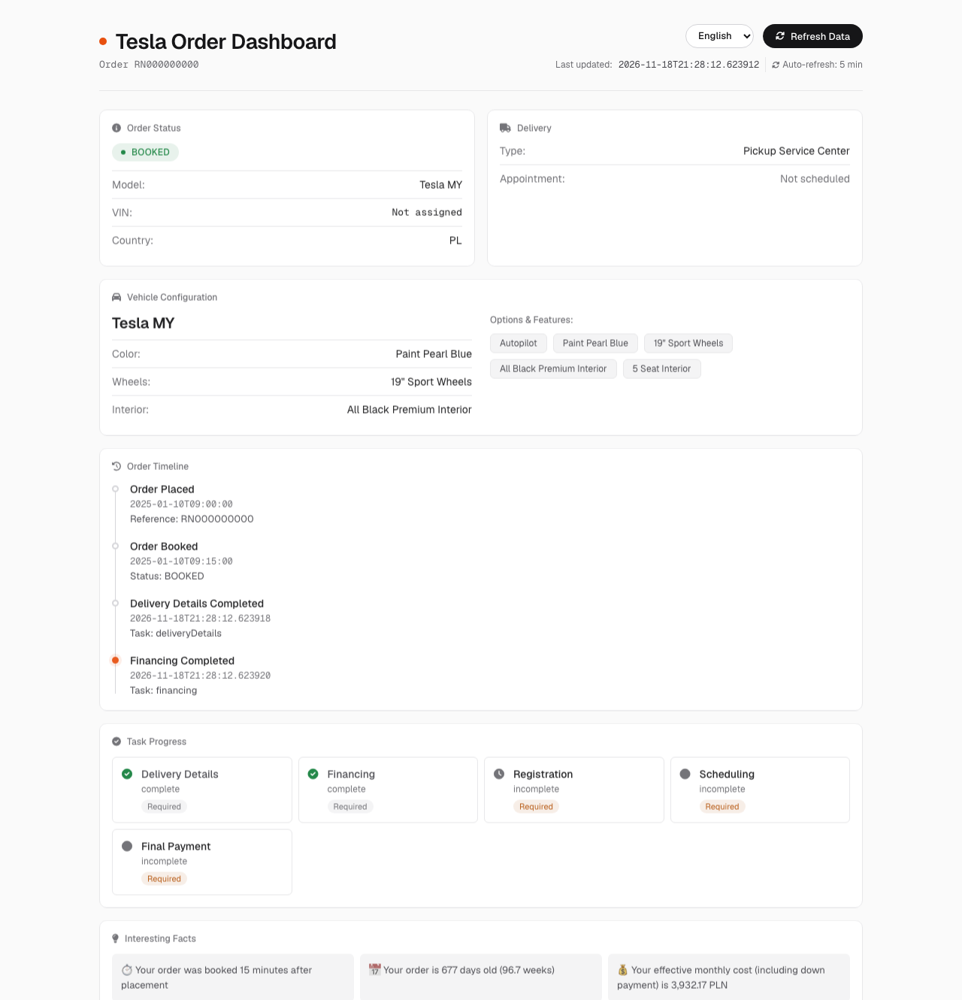

# Tesla Order Dashboard

A small self-hosted web dashboard that shows the status of your Tesla order (timeline, task progress, financing summary, vehicle configuration, delivery info, VIN notification) using the same unofficial Tesla endpoints as the Tesla mobile app. It runs on your own machine or on Railway. Your data stays with you: nothing is sent anywhere except to Tesla.

English and Polish UI. Polska wersja: see the end of this file.

> Unofficial. Not affiliated with Tesla. It uses undocumented endpoints that Tesla can change at any time.



## Where the data comes from

You do not need a Tesla developer account, a Fleet API application or any API key. A regular Tesla account, the one the order was placed on, is enough.

The script logs in the same way the official Tesla mobile app does (OAuth client `ownerapi`) and reads the same servers:

| Step | Server |
| --- | --- |
| Login | `auth.tesla.com` |
| List of your orders | `owner-api.teslamotors.com/api/1/users/orders` |
| Order details (tasks, delivery, VIN) | `akamai-apigateway-vfx.tesla.com/tasks` |

Your password is typed only on Tesla's own login page. The script receives tokens, stores them in a local file and talks to Tesla directly; there is no third-party server in between.

Two things to know:

- This API is unofficial and undocumented. Tesla can change or block it at any time. If the order details stop loading, check the upstream project for a newer `APP_VERSION`.
- The official Fleet API (the one that needs a developer account) is built for delivered vehicles and, as far as we know, does not expose order status before delivery, so it is not an alternative here.

## Features

- Order overview: status, model, VIN (when assigned), reference number
- Task progress (delivery details, financing, registration, scheduling, final payment, delivery acceptance) with a progress ring
- Financial summary and derived insights (cost per day / month, interest) when Tesla returns financing data
- Vehicle configuration decoded from Tesla option codes
- Delivery location (pickup center names come from `tesla_stores.py`) and appointment info
- One-click refresh from the Tesla API, 1 hour cache, optional auto-refresh in the browser
- Language switcher (English / Polish)
- Original command-line tracker (`tesla_order_status.py`) that prints order details and shows what changed since the last run

## Requirements

- Python 3.10 or newer
- A Tesla account with an order (a browser to log in once)
- Optional: a Railway account for hosting

## Installation

```sh
git clone https://github.com/mszyma/tesla-order-dashboard.git
cd tesla-order-dashboard
python3 -m venv .venv
source .venv/bin/activate        # Windows: .venv\Scripts\activate
pip install -r requirements.txt
```

## Log in to Tesla (creates your token file)

```sh
python3 tesla_order_status.py
```

1. Your browser opens the Tesla login page. Log in.
2. After login the browser lands on a "Page Not Found" page at `auth.tesla.com/void/callback`. That is expected. Copy the full URL from the address bar and paste it into the terminal.
3. Answer `y` to "save the tokens" and `y` to "save the order information".

This creates two files in the current directory:

| File | Contents |
| --- | --- |
| `tesla_tokens.json` | OAuth access and refresh tokens. Anyone with this file can read your Tesla account data. |
| `tesla_orders.json` | Your full order data (name, addresses, contact details, financing, VIN). |

Both are listed in `.gitignore`. Run the script from the repository folder so the dashboard finds them.

## Run locally

```sh
python3 run_local.py        # http://localhost:8000
# or
python3 app.py              # http://localhost:5000
```

Without `tesla_orders.json` the page shows an empty state; press Refresh after logging in. If the tokens are missing, the refresh button tells you what to do.

To see the dashboard without a Tesla account, copy `examples/tesla_orders.example.json` to `tesla_orders.json` (completely made-up data).

## Deploy to Railway

The dashboard shows your VIN, address and financing, so it is protected with HTTP Basic Auth. `DASHBOARD_PASSWORD` is required for every deployment outside your own computer: without it the app answers only direct requests from localhost and returns 503 behind Railway. Never commit token or order files to make a deployment work; tokens go in an environment variable (below).

1. Push this repo to your own (preferably private) GitHub repository. Never commit token or order files.
2. In Railway: New Project, Deploy from GitHub repo. `Procfile` and `railway.toml` configure gunicorn and the `/health` check.
3. Set environment variables:

| Variable | Required | Meaning |
| --- | --- | --- |
| `DASHBOARD_PASSWORD` | yes | Password for the browser login prompt. Without it the dashboard refuses remote requests, because it would otherwise be open to anyone with the URL. |
| `DASHBOARD_USER` | no | Login name, default `admin`. |
| `SECRET_KEY` | recommended | Long random string for Flask sessions (for example `python3 -c "import secrets; print(secrets.token_hex(32))"`). If unset, a random key is generated at each start. |
| `TESLA_TOKENS_JSON` | yes | The content of your local `tesla_tokens.json` on one line. The app reads it instead of the file, then fetches orders itself on first refresh. |
| `PORT` | no | Set by Railway. |

4. Open the generated domain and press Refresh. Railway's filesystem is ephemeral, so the order cache is rebuilt after each deploy; that is fine.

See `DEPLOYMENT.md` for troubleshooting.

## Analysis scripts

`tesla_order_analyzer.py`, `tesla_insights_generator.py` and `tesla_dashboard.py` print reports from `tesla_orders.json` and write text/JSON exports. See `README_ANALYSIS.md`.

## Privacy: never commit these files

Never commit, share or paste in issues:

- `tesla_tokens.json`
- `tesla_orders.json`
- `tesla_order_analysis.json`
- `tesla_order_analysis_report.txt`
- `tesla_order_dashboard.txt`
- `tesla_order_insights.txt`
- `dashboard_cache.json`
- `.env` files

They contain tokens and personal data. All of them are in `.gitignore`. Before pushing, run `git status` and check. If you committed a token by accident, revoke access by changing your Tesla password, and remove the file from the git history (not just the latest commit).

## Credits

The core of this project, `tesla_order_status.py` (login and order retrieval) and `tesla_stores.py` (delivery center names), comes from [niklaswa/tesla-order-status](https://github.com/niklaswa/tesla-order-status). The Flask dashboard, analysis scripts, translations and Railway setup were added on top. The upstream repository does not publish a license, so check with its author before reusing the code beyond personal use.

## Po polsku (skrót)

Dashboard pokazuje status zamówienia Tesli (oś czasu, postęp zadań, finansowanie, konfigurację, odbiór) i ma interfejs po polsku.

Nie potrzebujesz konta deweloperskiego Tesli ani Fleet API. Wystarczy zwykłe konto Tesla, na którym złożono zamówienie: skrypt loguje się tak jak aplikacja Tesli na telefon i pobiera dane prosto z serwerów Tesli. To nieoficjalne API, Tesla może je w każdej chwili zmienić.

1. `pip install -r requirements.txt`
2. `python3 tesla_order_status.py`: zaloguj się, po przekierowaniu na stronę z błędem skopiuj cały adres z paska przeglądarki do terminala, zapisz tokeny i zamówienia.
3. `python3 run_local.py` i otwórz http://localhost:8000. Język zmienisz przełącznikiem na stronie.
4. Na Railway ustaw `SECRET_KEY` i `TESLA_TOKENS_JSON` (zawartość `tesla_tokens.json`). Ustaw też `DASHBOARD_PASSWORD` (hasło Basic Auth, login domyślnie `admin`): bez niego aplikacja odmawia zdalnych żądań.
5. Nigdy nie wrzucaj na GitHub plików `tesla_tokens.json`, `tesla_orders.json` ani raportów (lista wyżej): zawierają tokeny i dane osobowe.
